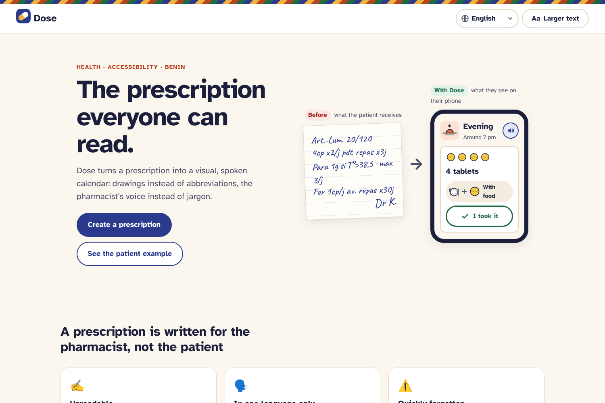
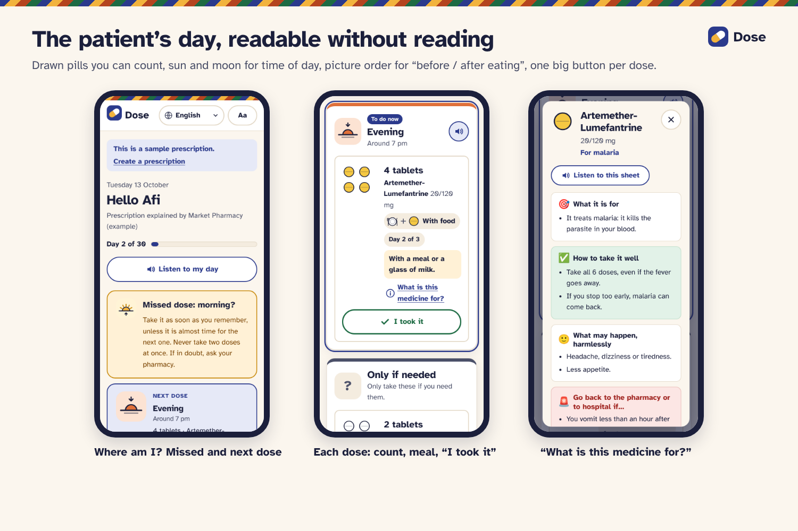
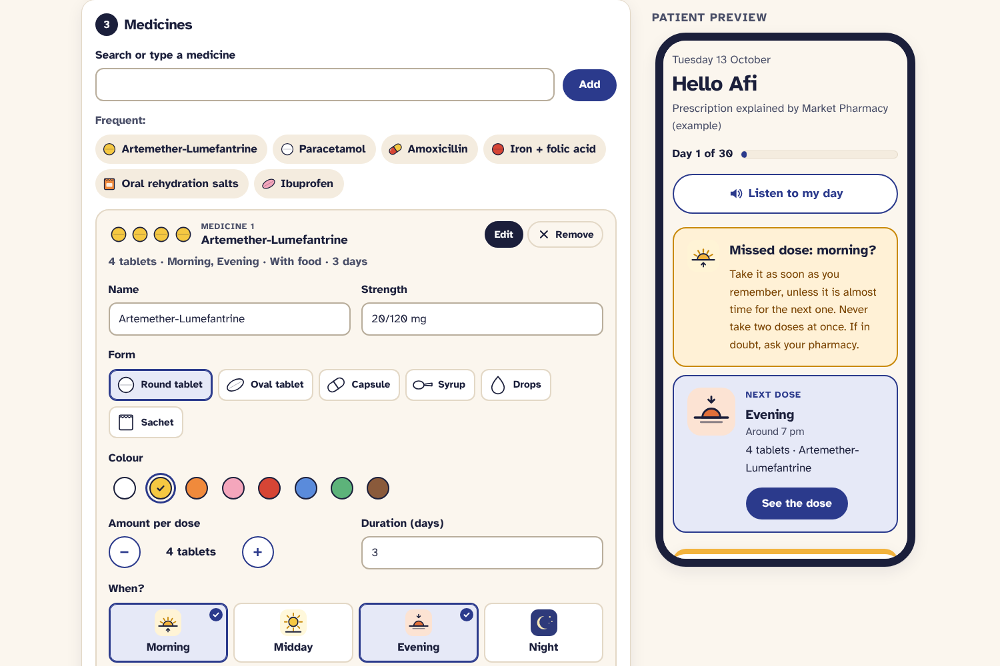
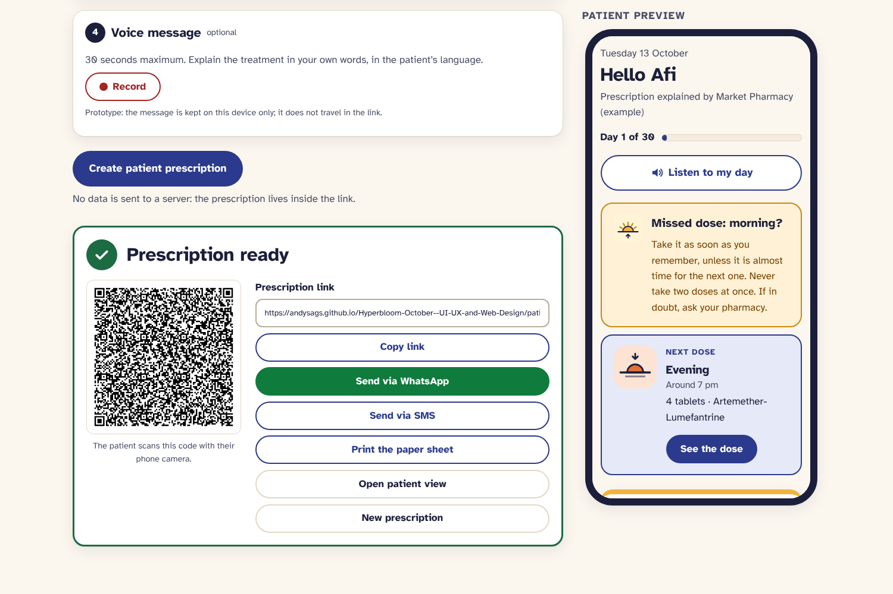
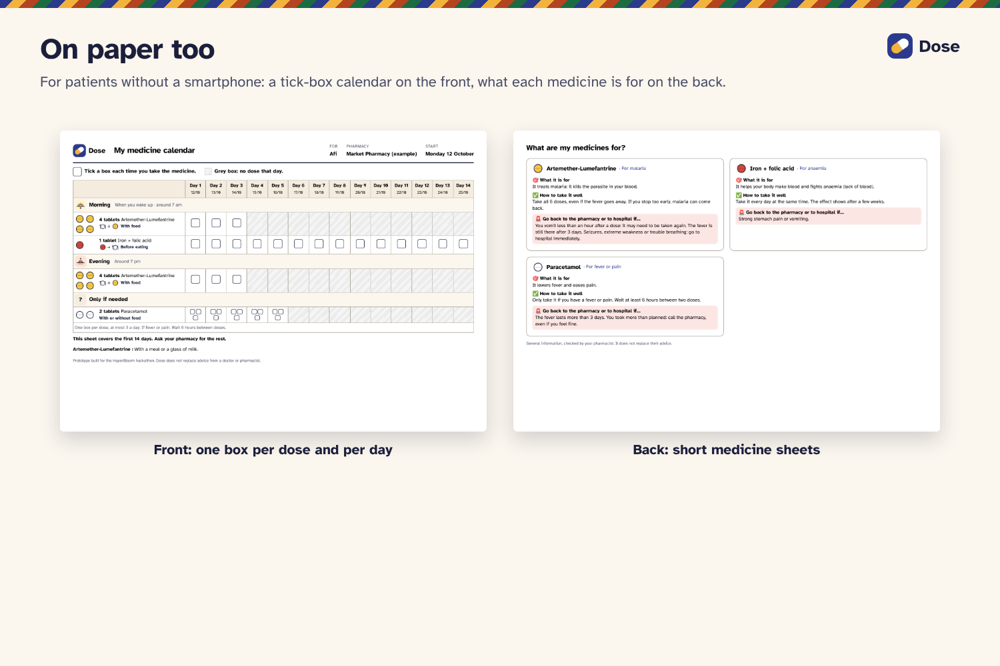

# Dose: a case study

> **The prescription everyone can read.**
> Dose turns a prescription into a visual, spoken calendar: drawings instead of abbreviations, the pharmacist's voice instead of jargon.

**Live prototype:** https://andysags.github.io/Hyperbloom-October--UI-UX-and-Web-Design/
**Context:** HyperBloom October: UI/UX & Web Design hackathon
**Deliverable:** working, responsive front-end prototype (no backend), plus a printable paper version

---

## 1. The problem

A prescription is written **for the pharmacist, not for the patient**: handwriting, abbreviations (“1 tab x3/d w/ meals”), medical vocabulary, and, in Benin, almost always in French.

Many patients in Benin and across West Africa:

- do not read French fluently, or do not read at all. Only about **half of adults in Benin can read** (adult literacy around 47 to 51 % in 2022, UNESCO data), with a gender gap of more than 20 points;
- speak a local language first (Fon, Yoruba, Mina, Dendi, Baatonum…);
- get a quick spoken explanation at the counter, then forget it on the way home;
- own a basic phone or a shared Android phone, often with a patchy connection.

The consequences are wrong doses, missed doses, and treatments stopped too early. That last one is especially dangerous for antimalarials and antibiotics. The WHO estimates that adherence to long-term treatments averages only about 50 %, and is lower in developing countries (*Adherence to Long-Term Therapies*, 2003). Not understanding the instructions is one of the direct causes.

### Where Dose fits

Dose does not replace the doctor or the prescription. It sits **at the pharmacy counter**, the exact moment when the explanation is given and then lost. The pharmacist is the right person to act there: they already explain the treatment, they know the medicine in the patient's hand, and they often speak the patient's language.

---

## 2. Who we design for

| Who | Situation | Core need |
|---|---|---|
| **Pharmacist / pharmacy assistant** | Busy counter, queue of patients | Fill it in **in under a minute**, with no account and no training |
| **Patient** | Limited reading, local language, any kind of phone | Know **what, when, how many, before or after eating** |
| **Caregiver** (child, relative) | Often the one with the smartphone who “reads the papers” for the family | Help a parent follow the treatment |

### Proto-personas (hypotheses to validate)

> These personas are **assumptions** built from the context and from the published research in section 3. We did not run interviews during the hackathon, and we say so on purpose.

- **Mama Afi, 58, market trader in Cotonou.** Speaks Fon and reads very little French. Shares an Android phone with her daughter. She has malaria: an antimalarial taken as 4 tablets morning and evening, plus iron and paracetamol.
- **Rodrigue, 34, pharmacy assistant near Cotonou.** Serves dozens of customers a day and already writes doses on the boxes with a pen. He has no time to explain everything twice.
- **Esther, 22, student, Afi's daughter.** Reads the medical papers for her mother, but lives in another town.

---

## 3. Research

We had no time to run field interviews during the hackathon, so we based the design on **published research**, then turned it into assumptions that the prototype makes testable.

### What the research says

| Source | Finding | What it changed in Dose |
|---|---|---|
| **Dowse & Ehlers (2005)**, *Medicine labels incorporating pictograms: do they influence understanding and adherence?*, Patient Education and Counseling 58(1). Randomised study with 87 patients with low formal schooling on a short antibiotic course, South Africa. | With pictograms added to the label, average **understanding rose from 70 % to 95 %** and average **adherence from 72 % to 90 %**. 54 % of the pictogram group reached over 90 % adherence, against 2 % of the text-only group. | Pictures are the **main channel**, not decoration: drawn pills, moments of the day, meal sequences. |
| **Katz, Kripalani & Weiss (2006)**, *Use of pictorial aids in medication instructions: a review of the literature*, American Journal of Health-System Pharmacy 63. | Pictorial aids improve recall, comprehension and adherence, especially for **dose timing** and **finishing a course**. Combining **text, speech and pictures** works best. **Clock icons were too complex** to help. | **No clock**: sun and moon instead. Text, pictures *and* voice on every dose. “Day 2 of 3” and “Last day” to finish the course. |
| **WHO (2003)**, *Adherence to Long-Term Therapies: Evidence for Action*. | Adherence to long-term treatments averages about 50 %, lower in developing countries. | The missed-dose guidance, the daily maximum for “only if needed” medicines, and the end-of-treatment message. |
| **UNESCO data via the World Bank (2022)**: adult literacy in Benin. | Around half of adults can read, with a gap of more than 20 points between men and women. | Zero reading required, a voice message in the patient's language, and a paper version. |

> Note on these sources: the Dowse & Ehlers sample is small and comes from a single clinic, and the WHO's 50 % figure is a widely quoted estimate built on old studies. We use them as **direction**, not as proof that Dose works.

### Assumptions the prototype makes testable
1. A count of drawn pills is understood faster than a number.
2. The *order* of pictures (pill → plate, or plate → pill) communicates “before / after eating” without text.
3. Sun and moon pictograms are understood faster than clock times.
4. A pharmacist will spend about one minute on this if most fields are pre-filled.
5. A voice message from a known person is trusted more than a synthetic voice.

### How we would validate them
- A **5-second test** in a pharmacy: show one dose card with no explanation, then ask *“What do you have to do, and when?”*
- Short interviews with a pharmacist, a patient and a caregiver. The guide is ready in the [design brief](DESIGN_BRIEF.md).
- Timing pharmacists filling in a real prescription.

---

## 4. Design principles

1. **Zero reading required** to understand a dose. Text is always present, but never the only channel.
2. **One day at a time.** The patient sees today, split into four moments of the day, and nothing else.
3. **Never colour alone.** A pill's colour always comes with a shape, a drawing and a label.
4. **The pharmacist's voice, not a robot's.** Local languages are carried by a human recording.
5. **Paper is a first-class channel**, not a fallback.
6. **Private by design.** No account, no database: the prescription lives inside the link.

---

## 5. Key design decisions

### Quantity you can count
**4 tablets = 4 drawings.** Above 4, a single drawing followed by “× 6” avoids an unreadable row. The pills are drawn with their real **shape and colour**, so the patient can match the screen to the tablet in their hand. A dark outline keeps a white tablet visible on a white screen.

### Time of day without a clock
Four moments, each with a pictogram you can tell apart without reading the time: **rising sun** (arrow up), **high sun**, **setting sun** (arrow down, orange), **moon**. Morning and evening differ by three cues (arrow direction, colour, background), not by colour alone.

### “Before / after eating” told by picture order
💊 → 🍽️ means *before eating*; 🍽️ → 💊 means *after*; 🍽️ + 💊 means *with food*. The text label is always shown next to it.

### One big action per dose
“I took it” is a 60 px button, the most frequent action in the app. Its state changes **colour, text and icon** together, and it is announced to screen readers.

### Safety built into the flow
- **Missed dose:** *“Take it as soon as you remember, unless it is almost time for the next one. Never take two doses at once.”*
- **“Only if needed” medicines** (paracetamol…): a dot counter (●○○ 1 of 3) and a button that **locks at the daily maximum**.
- **Finish the course:** “Day 2 of 3”, “Last day”, and an end-of-treatment message. The medicine sheet explains *why* stopping early is risky.

### “What is this medicine for?” with progressive disclosure
Each medicine has a short sheet with five blocks: 🎯 what it is for · ✅ how to take it well · 🙂 what may happen, harmlessly · 🚨 when to come back · 🚫 what to avoid. There are **at most 3 items per block**, and harmless effects are kept apart from warning signs. A long list of side effects makes people stop their treatment. The sheet opens on demand, so the daily screen stays simple.

**The pharmacist stays in control:** the sheet is pre-filled from the catalogue, but they can edit the *“For…”* line or hide the sheet. The same medicine can treat different conditions, and some patients would rather keep a diagnosis private.

### A pharmacist form built for a queue
- **Frequent medicines in one tap**, and search with pre-filled form, colour, dose, times and duration.
- **Catalogue medicines arrive collapsed** with a one-line summary (*“4 tablets · Morning, Evening · With food · 3 days”*). The pharmacist checks it at a glance and only opens the card to change something.
- **A live preview** of the patient's phone sits next to the form, so there is no surprise for the patient.
- **Errors are summarised at the top** with links to the fields, and the faulty card opens itself.

### Hand-off on the patient's terms
QR code, link, **WhatsApp** (widely used in Benin), SMS, or a **printed sheet**.

---

## 6. The flows

**Pharmacist (under a minute):** patient name and language → medicines (search or one tap) → check the summaries → optional voice message → *Create* → QR / WhatsApp / SMS / print.

**Patient:** open the link → *“Hello Afi · Day 2 of 3”* → where am I (missed / next dose) → each moment of the day → *I took it* → *What is this medicine for?* → *Listen to my day*.

**Paper:** front: a 14-day tick-box calendar, grouped by moment of the day, with greyed boxes once a medicine is finished. Back: short medicine sheets.

---

## 7. Visual design

- **Typeface: Atkinson Hyperlegible**, designed by the Braille Institute for low-vision readers. Look-alike characters (I l 1 · O 0 · b d) have distinct shapes.
- **Colours:** a warm cream background (less glare than pure white in bright sun), deep indigo for actions, green for “taken”. The colours of the moments of the day are **decoration only** and never carry text.
- **Identity:** a thin band inspired by West African woven textiles, and a two-tone capsule logo.
- **Style guide:** [styleguide.html](../styleguide.html) shows every token, with contrast ratios computed live.

---

## 8. Accessibility

| Area | What we did |
|---|---|
| Contrast | All text **WCAG AA** or better. Main text is AAA (ink on cream 14.9:1) |
| Colour | Never the only carrier of information (shape, drawing, label, icon) |
| Touch targets | **48 px minimum**; the main action is 60 px |
| Text size | “Larger text” mode (+25 %), remembered per device |
| Keyboard | Full navigation, visible focus ring, skip link, modal sheet with focus return |
| Screen readers | Semantic landmarks and headings, labelled buttons (*“I took it: Amoxicillin, evening”*), `aria-pressed` states, `aria-live` confirmations |
| Motion | `prefers-reduced-motion` respected |
| Low literacy | Drawn quantities, pictograms, picture order, text-to-speech, pharmacist's voice |
| Languages | Interface in **French, English, Spanish, Portuguese, Italian**. The patient's screen opens in their language. Local languages are carried by the voice message |
| Connectivity | Static, lightweight pages; no account; works from a link or on paper |

---

## 9. Iterations during the build

- **Mobile dose cards were too tall.** We moved the pills into a 2 × 2 block next to the text, with the button below.
- **The pharmacist form was too long** once several medicines were added. Catalogue medicines now arrive **collapsed with a summary**.
- **The preparation timer** was hidden when the form is filled from the example, because it would not reflect a real entry.
- **Languages.** For an international jury, we added Spanish, Portuguese and Italian **without removing** Benin's local languages, which are the reason the project exists.

---

## 10. Limits and ethics

- **Medical content** in the catalogue sheets is general and cautious, based on package leaflets and WHO guidance. It is **marked as indicative** and must be validated by a pharmacist before any real use.
- **Voice messages** are stored on the pharmacist's device in this prototype; a real product would need secure storage.
- **Text-to-speech** quality depends on the voices installed on the device.
- **Prescriptions in a link:** private, but anyone who has the link can read it. That is the same as a paper prescription, and it is the reason we keep it explicit.

---

## 11. What's next

1. Validate the assumptions in section 3 in a real pharmacy (5-second test, interviews, timing), then iterate.
2. Reminders by SMS (works on basic phones) and an installable PWA.
3. A synchronised caregiver view.
4. Secure, short-lived storage for voice messages.
5. A larger, pharmacist-validated catalogue with real box photos.

---

## 12. How it is built

Plain **HTML, CSS and JavaScript**, with no framework and no build step. It uses the Web Speech API (text-to-speech), MediaRecorder (voice messages), `<dialog>` (medicine sheet) and print CSS (paper sheet). The prescription is encoded in the URL as JSON → UTF-8 → base64url. The QR code uses *qrcode-generator*. Hosted on GitHub Pages. Every page was checked in a headless browser at phone and desktop sizes, with an automated check that all 5 translations are complete.

---

## Sources

- Dowse R., Ehlers M. (2005). *Medicine labels incorporating pictograms: do they influence understanding and adherence?* Patient Education and Counseling, 58(1), 63–70. [Rhodes University repository](https://vital.seals.ac.za/vital/access/manager/Repository/vital:6359)
- Katz M. G., Kripalani S., Weiss B. D. (2006). *Use of pictorial aids in medication instructions: a review of the literature.* American Journal of Health-System Pharmacy, 63, 2391–2397. [University of Arizona](https://experts.arizona.edu/en/publications/use-of-pictorial-aids-in-medication-instructions-a-review-of-the-/)
- World Health Organization (2003). *Adherence to Long-Term Therapies: Evidence for Action.* [WHO news release](https://www.who.int/news/item/01-07-2003-failure-to-take-prescribed-medicine-for-chronic-diseases-is-a-massive-world-wide-problem)
- Adult literacy rate, Benin (UNESCO Institute for Statistics data). [World Bank gender data profile](https://genderdata.worldbank.org/data/download/pdfs/countries/benin.pdf) · [UN LDC profile](https://policy.desa.un.org/sites/default/files/2025-06/ldc_profile_benin.pdf)

*Prototype. Dose does not replace advice from a doctor or pharmacist.*
